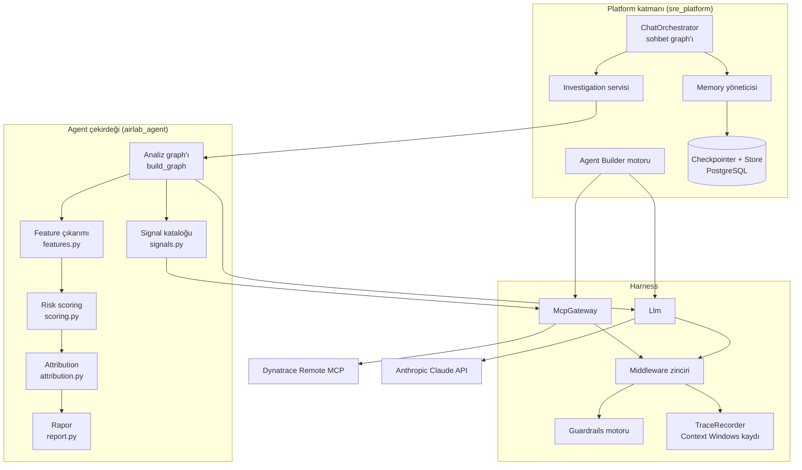
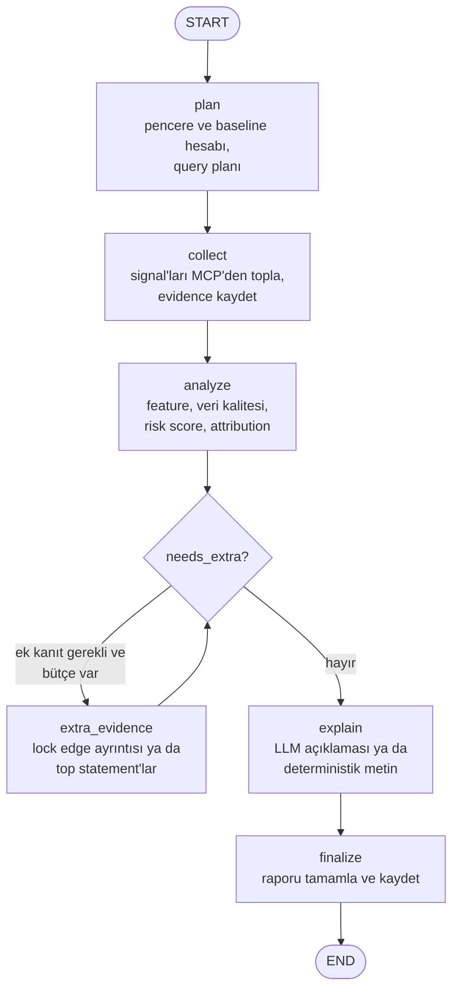
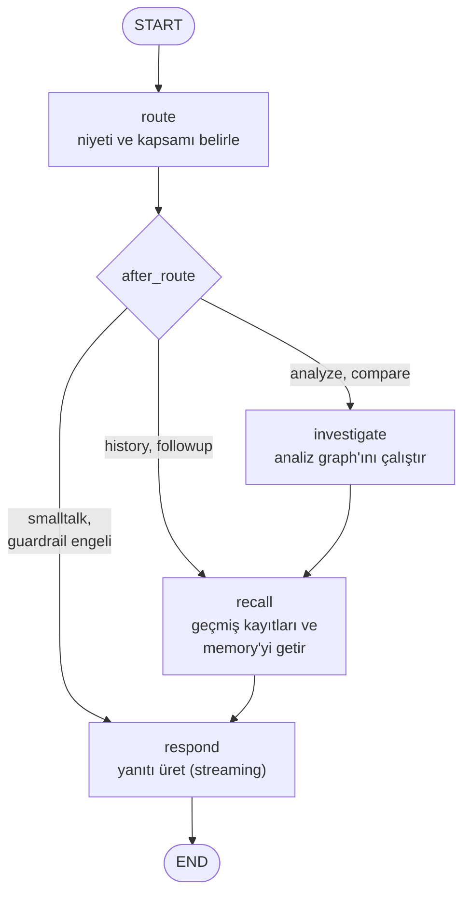
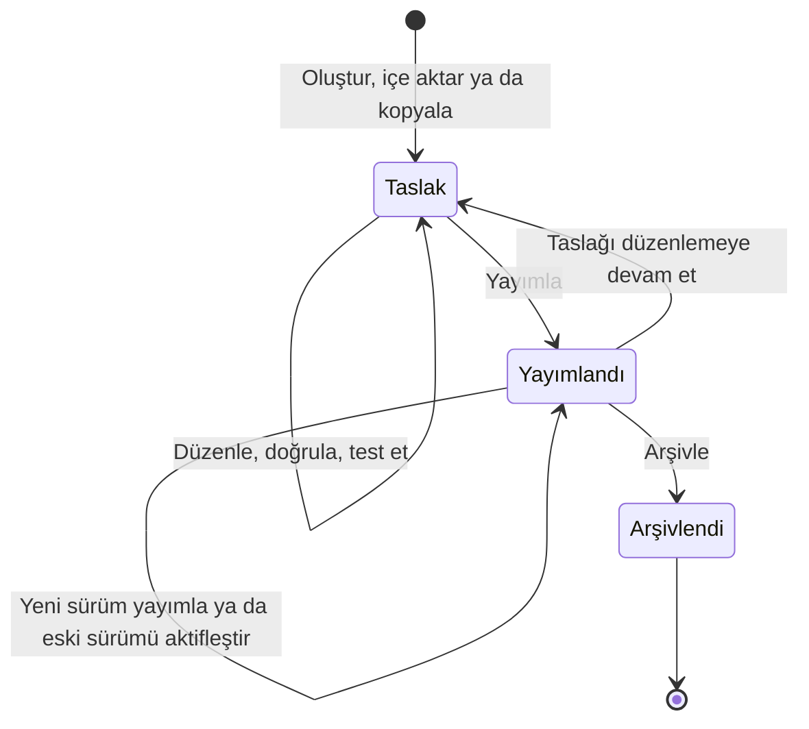

# AI Agent ve Agent Harness Mimarisi

Bu doküman SRE Agent'ın nasıl çalıştığını ve onu çevreleyen "harness" katmanını (MCP gateway, LLM adapter'ı, memory,
middleware, guardrails, izleme) mevcut implementasyona göre anlatır. Platformun genel yapısı için:
[Teknik Mimari](TECHNICAL_ARCHITECTURE.md). Adım adım akışlar için: [Çalışma Akışları](WORKFLOWS.md).

[← Dokümantasyon merkezine dön](../README.md)

## İçindekiler

- [1. Tasarım ilkeleri](#1-tasarım-ilkeleri)
- [2. Gömülü agent ve custom agent](#2-gömülü-agent-ve-custom-agent)
- [3. Bileşenler ve sorumlulukları](#3-bileşenler-ve-sorumlulukları)
- [4. Analiz graph'ı](#4-analiz-graphı)
- [5. Sohbet graph'ı](#5-sohbet-graphı)
- [6. MCP ve tool calling](#6-mcp-ve-tool-calling)
- [7. LLM katmanı](#7-llm-katmanı)
- [8. Prompt ve context yönetimi](#8-prompt-ve-context-yönetimi)
- [9. Evidence, risk scoring ve Root Cause ataması](#9-evidence-risk-scoring-ve-root-cause-ataması)
- [10. Memory ve checkpointing](#10-memory-ve-checkpointing)
- [11. Middleware](#11-middleware)
- [12. Guardrails](#12-guardrails)
- [13. Retry, fallback ve bütçeler](#13-retry-fallback-ve-bütçeler)
- [14. Observability: neler kaydedilir?](#14-observability-neler-kaydedilir)
- [15. Custom agent lifecycle](#15-custom-agent-lifecycle)

## 1. Tasarım ilkeleri

| İlke | Uygulamadaki karşılığı |
|---|---|
| **Analiz deterministiktir.** | Feature çıkarımı, risk score ve mechanism ataması Python kurallarıdır. Aynı veri aynı sonucu verir. |
| **LLM yorumlar ve açıklar, karar vermez.** | LLM üç iş yapar: soruyu yapılandırılmış isteğe çevirir, sohbeti yönlendirir, bulguları anlatır. Skoru değiştiremez. |
| **LLM tool çağırmaz.** | Gömülü agent'ta hangi query'nin çalışacağını kod belirler (sabit signal kataloğu). Modele tool tanımı verilmez. |
| **Agent salt okunurdur.** | Tek tool `execute-dql`'dir. Sistem değiştiren her adım insan onayına gider. |
| **Eksik veri sıfır değildir.** | Her signal bir veri durumu taşır; ölçülemeyen bileşen skora katılmaz ve raporda belirtilir. |
| **Kesinti analizi durdurmaz.** | MCP ya da LLM'e ulaşılamazsa kısmi rapor ve deterministik açıklama üretilir. |

Karar kaydı: [ADR-007](lab/decisions/ADR-007-sre-agent.md).

## 2. Gömülü agent ve custom agent

Platformda iki tür agent vardır. Aynı altyapıyı (LLM istemcisi, MCP gateway, middleware, guardrails, izleme) kullanırlar
ama yapıları farklıdır.

| | Gömülü agent ("SRE Agent") | Custom agent |
|---|---|---|
| Tanım | Kodda sabit iki LangGraph graph'ı | Agent Builder'da çizilen workflow (JSON tanım) |
| Kim oluşturur | Platformla birlikte gelir | `agent:build` yetkili kullanıcı |
| Değiştirilebilir mi | Hayır (yalnız Settings'ten threshold, bütçe, model) | Evet: taslak → doğrulama → yayım → sürüm |
| Analiz mantığı | Deterministik feature, scoring, attribution | Kullanıcının kurduğu node zinciri; risk score üretmez |
| LLM'in rolü | Yorumlama ve açıklama | Workflow'daki LLM node'ları ne isterse |
| MCP kullanımı | Sabit signal kataloğu (18 signal) | MCP Tool node'undaki salt okunur DQL |
| Çıktı | Investigation kaydı, risk score, mechanism, RCA'ya dönüşebilir | Metin ya da structured output; `agent_runs` kaydı |
| Çalıştırma | AI Investigation, watch, health check | AI Investigation'da agent seçimi, test çalıştırması, schedule |
| Kaynak | [`graph.py`](../sre-agent/src/airlab_agent/graph.py), [`agent/chat.py`](../sre-platform/backend/sre_platform/agent/chat.py) | [`builder/engine.py`](../sre-platform/backend/sre_platform/builder/engine.py) |

## 3. Bileşenler ve sorumlulukları

| Bileşen | Sorumluluk | Kaynak |
|---|---|---|
| `build_graph`, `run_analysis` | Analiz graph'ını kurar ve çalıştırır | [`graph.py`](../sre-agent/src/airlab_agent/graph.py) |
| `ChatOrchestrator` | Sohbet graph'ı: yönlendirme, analiz çağrısı, hafıza, yanıt | [`agent/chat.py`](../sre-platform/backend/sre_platform/agent/chat.py) |
| Signal kataloğu | 18 signal için DQL şablonları ve pencere hesabı | [`signals.py`](../sre-agent/src/airlab_agent/signals.py) |
| `extract`, `assess_quality` | Query sonuçlarından feature ve veri kalitesi | [`features.py`](../sre-agent/src/airlab_agent/features.py) |
| `score_all` | Uygulama başına risk score | [`scoring.py`](../sre-agent/src/airlab_agent/scoring.py) |
| `detect`, `alternatives` | Mechanism tespiti, source uygulama, alternatif açıklamalar | [`attribution.py`](../sre-agent/src/airlab_agent/attribution.py) |
| `deterministic_explanation` | LLM olmadan rapor metni | [`report.py`](../sre-agent/src/airlab_agent/report.py) |
| `McpGateway` | MCP oturumu, DQL doğrulama, retry, sonuç sınıflandırma | [`mcp_gateway.py`](../sre-agent/src/airlab_agent/mcp_gateway.py) |
| `Llm`, `RunBudget` | Claude istemcisi, görev profilleri, çağrı ve token bütçesi | [`llm.py`](../sre-agent/src/airlab_agent/llm.py) |
| Middleware zinciri | Her LLM ve MCP çağrısının önünde ve arkasında çalışan denetimler | [`middleware.py`](../sre-agent/src/airlab_agent/middleware.py) |
| Guardrails | Girdi, tool çağrısı, çıktı ve memory üzerinde policy değerlendirmesi | [`guardrails/`](../sre-agent/src/airlab_agent/guardrails/) |
| `TraceRecorder` | Graph, LLM ve tool event'lerinin kaydı | [`agent_trace.py`](../sre-agent/src/airlab_agent/agent_trace.py) |
| Context Windows kaydı | Her LLM çağrısının token dökümü | [`context_window.py`](../sre-agent/src/airlab_agent/context_window.py) |
| Watch | Sürekli izleme durum makinesi (LLM'siz) | [`watch.py`](../sre-agent/src/airlab_agent/watch.py) |
| Yapılandırma | Threshold'lar, ağırlıklar, bütçeler | [`defaults.yaml`](../sre-agent/src/airlab_agent/defaults.yaml), [`config.py`](../sre-agent/src/airlab_agent/config.py) |

## 4. Analiz graph'ı

Bir analiz, LangGraph `StateGraph` olarak tanımlı altı node'dan geçer. Her node `guard_node` ile sarılıdır; guardrails
node'dan önce ve sonra değerlendirilir.

| Node | Ne yapar | LLM | MCP |
|---|---|---|---|
| `plan` | İncelenen pencereyi ve hemen öncesindeki baseline'ı belirler, ingest gecikmesini düşer | – | – |
| `collect` | Katalogdaki signal'ları çalıştırır; her sonucu veri durumuyla evidence olarak yazar | – | Evet |
| `analyze` | Feature çıkarır, veri kalitesini ölçer, risk score ve mechanism'i hesaplar | – | – |
| `extra_evidence` | `row_lock`, `table_lock` ya da `advisory_lock` bulunduysa lock edge ayrıntısını, `db_cpu`, `global_connection_pressure`, `db_memory_pressure` ya da bir PostgreSQL workload mechanism'i bulunduysa en pahalı statement'ları toplar | – | Evet |
| `explain` | Bulguları Türkçe anlatır. LLM yoksa, ulaşılamazsa ya da guardrail engellerse deterministik metin kullanılır | Evet | – |
| `finalize` | Durumu (`completed` / `partial`) belirler, raporu oluşturur | – | – |

Ek kanıt turu en fazla `max_iterations` (varsayılan 2) kez döner. Graph `recursion_limit=25` ile çalışır.

### State

Graph'ın durumu `AgentState` adlı bir `TypedDict`'tir. Başlıca alanlar:

| Alan | İçerik |
|---|---|
| `question`, `start`, `end`, `baseline_start`, `baseline_end` | İstek ve zaman pencereleri |
| `windows`, `results` | Query planı ve ham sonuçlar |
| `evidence` | Evidence kayıtları (kimlik, signal, veri durumu, satır sayısı) |
| `quality` | Signal ve uygulama başına data coverage |
| `features_summary`, `scores`, `attribution`, `alternatives` | Analiz çıktıları |
| `extra`, `iterations` | Ek kanıt turları |
| `explanation`, `explanation_source` | Açıklama metni ve kaynağı (`claude` ya da `deterministic`) |
| `budget`, `errors`, `status`, `notes` | Bütçe kullanımı, hatalar, durum |

Checkpointer verildiğinde state her node'dan sonra PostgreSQL'e yazılır; yarıda kalan bir çalışma kaldığı node'dan
sürdürülebilir.

## 5. Sohbet graph'ı

AI Investigation ekranındaki her kullanıcı mesajı ikinci bir graph'tan geçer. Bu graph analiz graph'ını bir node
içinden çağırır.

| Node | Ne yapar |
|---|---|
| `route` | Soruyu `AnalysisRequest` yapısına çevirir (uygulama, zaman aralığı, niyet). LLM yoksa sezgisel bir ayrıştırıcı kullanılır (`heuristic_request`). |
| `investigate` | Analiz graph'ını çalıştırır; sonuç investigation kaydı olur. |
| `recall` | Benzer geçmiş investigation'ları, episodic memory kayıtlarını, runbook'ları ve bilinen sorunları getirir. |
| `respond` | Bulgulardan ve getirilen kayıtlardan yanıt üretir; token'lar SSE ile akar. Takip sorusu önerileri ekler. |

`ChatState` alanları: `messages`, `focus` (konuşma odağı), `digests` (eski turların özetleri), `question`, `route`,
`investigation`, `memory`, `answer`, `answer_source`, `suggestions`, `last_investigation_id`.

Niyetler: `analyze`, `compare`, `history`, `followup`, `smalltalk`. Guardrail girdiyi engellerse graph doğrudan
`respond` node'una gider ve engel nedeni bildirilir.

## 6. MCP ve tool calling

Agent ile Dynatrace arasındaki tek kapı `McpGateway`'dir.

| Konu | Davranış |
|---|---|
| Taşıma | MCP Streamable HTTP, `Authorization: Bearer` başlığı |
| Tool | Yalnız `execute-dql`. Tool listesi keşfedilir; onaylı tanımın hash'i saklanır ve her oturumda doğrulanır. |
| DQL doğrulama | `validate_dql` yalnız okuma query'lerine izin verir; yazma ya da yönetim komutları reddedilir. |
| Query kaynağı | Gömülü agent'ta query'ler katalogdan gelir; LLM query yazmaz. |
| Sonuç sınıflandırma | Her yanıt bir veri durumuna çevrilir (aşağıdaki tablo). |
| Retry | Geçici hatalarda aynı `call_id` ile yeniden denenir (`query_retries`, varsayılan 2). |
| Bütçe | Çalışma başına en fazla `max_queries_per_run` (varsayılan 40) query. |
| Kesinti | `McpUnavailable` (`timeout`, `unavailable`, `integrity`) → kısmi rapor. Yedek veri kaynağı yoktur. |

Veri durumları:

| Durum | Anlamı |
|---|---|
| `OK` | Veri geldi ve yeterli |
| `EMPTY` | Query çalıştı, satır yok |
| `STALE` | Son veri noktası pencere sonundan çok eski |
| `PERMISSION` | Token'da scope eksik |
| `ERROR` | Query hata verdi |
| `UNAVAILABLE` | MCP'ye ulaşılamadı |
| `SKIPPED_BUDGET` | Query bütçesi dolduğu için çalıştırılmadı |

Signal kataloğu (18 signal): `http`, `spans`, `hikari`, `jvm_gc`, `jvm_heap`, `hosts`, `containers`, `db_conn`,
`db_sessions`, `lock_waiters`, `collector`, `edges`, `pg_lock_logs`, `db_stats`, `statements`, `pg_server`, `pg_io`, `pg_error_logs`.
Her signal'ın kaynağı ve alanları: [telemetry-contract.md](lab/telemetry-contract.md).

Her MCP çağrısı platformda kaydedilir ve **MCP Çağrıları** ekranında görünür ([mcp-calls.md](platform/mcp-calls.md)).

## 7. LLM katmanı

| Konu | Davranış | Kaynak |
|---|---|---|
| Provider | Yalnız Anthropic (`langchain-anthropic`) | [`llm.py`](../sre-agent/src/airlab_agent/llm.py) |
| Görev profilleri | `chat` (yorumlama, yönlendirme, yanıt) ve `rca` (açıklama, RCA özeti); her birinin modeli, token sınırı, timeout'u ve effort değeri ayrıdır | `Llm` sınıfı |
| Model seçimi | Üst bar seçimi › Settings LLM profili › `CLAUDE_MODEL` / `CLAUDE_RCA_MODEL` | [`model_switch.py`](../sre-platform/backend/sre_platform/services/model_switch.py) |
| Structured output | Soru yorumlama `with_structured_output(AnalysisRequest, method="json_schema")` kullanır; yanıt şemaya uymak zorundadır | `Llm.interpret` |
| Akıl yürütme derinliği | `effort` parametresiyle ayarlanır (chat: `medium`, RCA: `high`) | [`defaults.yaml`](../sre-agent/src/airlab_agent/defaults.yaml) |
| Bütçe | `RunBudget` çalışma başına LLM çağrı ve token sayısını sınırlar; aşılırsa `LlmBudgetExceeded` | `RunBudget` |
| LLM'siz çalışma | Anahtar yoksa ya da `AGENT_DISABLE_LLM=true` ise tüm akış deterministik yürür | [`config.py`](../sre-agent/src/airlab_agent/config.py) |

LLM'e modelin çağırabileceği bir tool tanımı verilmez. Custom agent'larda da MCP çağrısını model değil, workflow'daki
**MCP Tool** node'u yapar.

## 8. Prompt ve context yönetimi

- **Prompt'lar kodda sabittir.** Sistem prompt'ları [`agent/prompts.py`](../sre-platform/backend/sre_platform/agent/prompts.py)
  ve [`llm.py`](../sre-agent/src/airlab_agent/llm.py) içindedir. Terminoloji ve yanıt üslubu kuralları
  [`terminology.yaml`](../sre-agent/src/airlab_agent/terminology.yaml) ve
  [`style.py`](../sre-agent/src/airlab_agent/style.py) ile eklenir.
- **Veri, talimattan ayrılır.** Analiz bulguları prompt'a etiketli veri blokları olarak konur. Telemetriden gelen metin
  (log satırı, query metni) talimat olarak yorumlanmaz.
- **Context sınırlanır.** Sohbette son mesajlar tutulur; eski turlar `digests` olarak özetlenir. Analiz verisi LLM'e
  gitmeden önce boyut sınırından geçer.
- **Hassas veri maskelenir.** Zorunlu `redaction` middleware'i secret ve kişisel veri kalıplarını LLM'e gitmeden önce
  maskeler ([`redact.py`](../sre-agent/src/airlab_agent/redact.py)).
- **Zaman gösterimi.** Kullanıcıya dönük metinlerde saatler Türkiye saatiyle yazılır
  ([`timefmt.py`](../sre-agent/src/airlab_agent/timefmt.py)).

Her LLM çağrısında context'in ne kadar dolduğu ve hangi bölümlerden oluştuğu **Context Windows** ekranında görülür
([context-windows.md](platform/context-windows.md)).

## 9. Evidence, risk scoring ve Root Cause ataması

### Risk score

Skor uygulama başına 0–100 arasındadır ve beş bileşenin ağırlıklı toplamıdır.

| Bileşen | Ağırlık | Ölçtüğü |
|---|---|---|
| `latency` | 0,30 | Yanıt süresinin baseline'a oranı |
| `errors` | 0,25 | 5xx oranındaki artış |
| `saturation` | 0,20 | Connection Pool ve veritabanı bağlantı doluluğu |
| `lock` | 0,15 | Lock bekleyen oturumlar |
| `resource` | 0,10 | Host ve container CPU kullanımı |

Bantlar: 25'in altı düşük, 25–50 orta, 50–75 yüksek, 75 ve üstü kritik. Bileşen ağırlığının en az %60'ı ölçülemiyorsa
skor üretilmez (`null`); eksik veri sıfır sayılmaz. Ağırlıklar ve threshold'lar **Settings › Risk Scoring** ekranından
değiştirilebilir ve değişiklik öncesinde geçmiş veriye karşı önizlenebilir.

Üç ayrı kavram birbirine karıştırılmaz:

| Kavram | Soru |
|---|---|
| **Risk score** | Etki ne kadar şiddetli? |
| **Data coverage** | Bu sonuca varmak için gereken verinin ne kadarı ölçülebildi? |
| **Confidence** | Nedensellik ataması ne kadar güvenilir? |

### Mechanism'ler

`attribution.detect` aşağıdaki mechanism'leri kural tabanlı olarak arar:

| Mechanism | Belirti |
|---|---|
| `row_lock` | Lock bekleyen oturumlar ve bloklayan / bekleyen çiftleri (lock edge) |
| `table_lock` | Aynı belirti; lock edge'lerin çoğunda bekleme türü `relation` (tablo düzeyinde lock) |
| `advisory_lock` | Aynı belirti; lock edge'lerin çoğunda bekleme türü `advisory` |
| `pool_saturation` | Bir uygulamanın Connection Pool'u dolu, bekleyen istek var |
| `global_connection_pressure` | Veritabanı toplam bağlantı kullanımı sınıra yakın ya da hızla artmış |
| `db_cpu` | Veritabanı host'unda CPU saturation. Alt neden: `query_load`, `maintenance`, `mixed`, `undetermined` |
| `app_vm_cpu` | Uygulama host'unda CPU saturation |
| `app_container_cpu` | Tek bir uygulama container'ında CPU artışı |
| `network_path_latency` | Uygulama yavaş, veritabanı sunucu tarafı execution time normal |
| `independent_load` | Yük artışı var, paylaşılan kaynak baskısı yok |
| `deadlock` | Deadlock sayacı ya da PostgreSQL logunda `deadlock detected` satırları |
| `serialization_conflict` | PostgreSQL logunda `could not serialize access` satırları |
| `temp_file_pressure` | Temp dosyası yazımı arttı (sort / hash `work_mem`'e sığmıyor) |
| `write_pressure` | Insert ve WAL hacmi arttı. Alt tür: `bulk_write`, `commit_heavy`. `commit_heavy`'de exec time artışı source eşiğinin altında kalırsa source, çağrı sayısı belirgin artan uygulamalardır |
| `update_churn` | Update hızı arttı; autovacuum aktivitesi ve vacuum'u engelleyebilecek session'lar ayrıca belirtilir |
| `read_pressure` | Okunan tuple hacmi ya da diskten okunan blok arttı (ör. sequential scan) |
| `db_memory_pressure` | Veritabanı host'unda memory kullanımı arttı |
| `idle_in_transaction` | Bir uygulamanın idle in transaction session'ları birikti |
| `query_flood` | Bir uygulamanın query çağrı sayısı çok arttı, çağrı başına süre çok kısa |

Her mechanism; source uygulamaları, etkilenen uygulamaları, dayandığı evidence kimliklerini ve bir confidence
düzeyini taşır. Sonuç bir **hipotez** olarak sunulur; alternatif açıklamalar ayrıca listelenir.

PostgreSQL workload mechanism'leri (`temp_file_pressure`, `write_pressure`, `update_churn`, `read_pressure`) `db_cpu`'dan
önce değerlendirilir; ikisi birlikte bulunursa `db_cpu` kaydı ilgili yükü `related_load` alanında gösterir. `deadlock` ve
`serialization_conflict` için source uygulama, log satırındaki database role'ünden çıkarılır. Eşikler
`defaults.yaml → mechanisms` altındadır ve lab ölçümlerinden seçilmiş ilk değerlerdir.

`db_cpu` nedeni `maintenance` olduğunda source uygulama gösterilmez: CPU'yu uygulama query'leri değil veritabanı bakım
aktivitesi (örneğin autovacuum) kullanıyordur.

### RCA raporu

RCA raporu bir investigation'dan üretilir ([`rca_service.py`](../sre-platform/backend/sre_platform/services/rca_service.py)).
Bölümlerin içeriği deterministiktir: bulgular, evidence kayıtları, incident zaman çizelgesi, bilgi bankası önerileri.
LLM varsa yalnız "Yönetici özeti" paragrafını yazar ve bu paragraf kaynağıyla birlikte işaretlenir.

## 10. Memory ve checkpointing

Dört hafıza katmanı vardır; hepsi PostgreSQL'dedir.

| Katman | Depo | İçerik | Ömür |
|---|---|---|---|
| Working memory | `langgraph` checkpoint'leri (konuşma `thread_id`) | Son mesajlar, konuşma odağı, tur özetleri | Konuşma |
| Episodic memory | `sre.agent_episodes` | Investigation başına belirti parmak izi → hipotez → sonuç | Investigation silinince silinir |
| İlişkisel kayıtlar | `sre` tabloları | Investigation, incident, RCA, runbook, bilinen sorun | Retention ayarına göre |
| Store | `langgraph` store | Kısa özetler (uygulama, kullanıcı, konuşma namespace'leri) | Otomatik silinmez |

- **Benzerlik araması embedding kullanmaz.** Episodic memory'de benzerlik, belirti parmak izlerinin Jaccard
  benzerliğiyle hesaplanır; metin araması PostgreSQL tam metin aramasıdır.
- **Memory ipucudur, kanıt değildir.** Geçmiş kayıtlar yanıta "daha önce benzer bir durum görüldü" bilgisi olarak
  girer; güncel risk score'u ya da mechanism'i değiştirmez.
- **Checkpointing.** Her iki graph da PostgreSQL checkpointer ile çalışır. Sohbet thread'i konuşma kimliğine bağlıdır;
  bu sayede backend yeniden başlasa da konuşma bağlamı korunur ve yarıda kalan çalışma sürdürülebilir.
- **Yönetişim.** Memory kayıtları sürümlenir; yazma, onay ve silme ayrı permission'lardır. Prosedürel memory kayıtları
  ikinci bir kişinin onayını gerektirir.

Ayrıntı: [agent-memory.md](platform/agent-memory.md), [docs/platform/memory/](platform/memory/).

## 11. Middleware

Her LLM ve MCP çağrısı bir middleware zincirinden geçer. Bu, LangChain'in `create_agent` middleware'i değildir;
platforma özgü bir zincirdir ([`middleware.py`](../sre-agent/src/airlab_agent/middleware.py)).

| Sıra | Middleware | Tür | Hook'lar | Zorunlu |
|---|---|---|---|---|
| 10 | `call_logging` | logging | `before_agent`, `after_agent`, `wrap_model_call`, `wrap_tool_call` | Hayır |
| 20 | `timing` | logging | `wrap_model_call`, `wrap_tool_call` | Hayır |
| 30 | `redaction` | redaction | `before_model` | **Evet** |
| 40 | `tool_allowlist` | authorization | `wrap_tool_call` | **Evet** |
| 50 | `tool_param_validation` | validation | `wrap_tool_call` | **Evet** |
| 60 | `call_limit` | limit | `before_model`, `wrap_tool_call` | **Evet** |
| 90 | `retry_observer` | retry | `wrap_tool_call` | Hayır |

Zorunlu middleware'ler kapatılamaz ve kapsamları daraltılamaz. Arayüzden yalnız kodda kayıtlı middleware'ler
yapılandırılabilir; kod çalıştırılamaz. `retry_observer` retry yapmaz, yalnız gateway'in yaptığı retry'ları gözlemler.

Ayrıntı: [agent-middleware.md](platform/agent-middleware.md).

## 12. Guardrails

Guardrails deterministik bir policy motorudur: kararı sabit kurallar verir, dil modeli vermez.

| Konu | Değer |
|---|---|
| Yerleşik policy sayısı | 46 |
| Kategoriler | `input`, `model_context`, `tool`, `mcp`, `data_protection`, `output`, `evidence`, `memory`, `execution`, `action` |
| Değerlendirme aşamaları | `before_agent`, `node_start`, `node_end`, `llm_request`, `llm_response`, `tool_request`, `mcp_request`, `tool_response`, `mcp_response`, `memory_read`, `memory_write`, `checkpoint`, `final_output`, `after_agent` |
| Aksiyonlar | `allow`, `block`, `warn`, `redact`, `sanitize`, `retry`, `fallback`, `require_approval`, `quarantine`, `terminate` |
| Modlar | `monitor` (yalnız kaydet), `enforce` (uygula), `disabled` |
| Çakışma çözümü | Deny-overrides: birden fazla policy eşleşirse en kısıtlayıcı karar geçerlidir |
| Kapsamlar | `global`, `tenant`, `environment`, `agent`, `mcp_server`, `tool`, `graph_node` |
| Kill switch | Yönetici tüm agent çalıştırmalarını tek ayarla durdurabilir |

Örnek policy'ler: yazma yetenekli tool çağrısının reddi, LLM girdisinde secret maskeleme, evidence kimliği olmayan
Root Cause iddiasının temizlenmesi, risk score bütünlüğü, prompt injection kalıpları.

Kaynak: [`guardrails/`](../sre-agent/src/airlab_agent/guardrails/) (motor),
[`sre_platform/guardrails/`](../sre-platform/backend/sre_platform/guardrails/) (kalıcılık ve API). Dokümanlar:
[Guardrails mimarisi](platform/guardrails/GUARDRAILS_ARCHITECTURE.md),
[policy referansı](platform/guardrails/GUARDRAILS_POLICY_REFERENCE.md).

## 13. Retry, fallback ve bütçeler

| Katman | Mekanizma | Varsayılan |
|---|---|---|
| MCP query | Gateway retry, aynı `call_id` | 2 retry, query başına 60 s timeout |
| LLM çağrısı | Anthropic SDK retry | 2 retry; chat 120 s, RCA 150 s timeout |
| LLM refusal | Anthropic sunucu tarafı fallback (`fallbacks: "default"`) | Açık |
| LLM'e ulaşılamıyor | Deterministik açıklamaya düşüş (`LlmUnavailable`) | Her zaman |
| Guardrail engeli | Deterministik açıklamaya düşüş (`GuardrailBlocked`) | Her zaman |
| Query bütçesi | `max_queries_per_run` | 40 |
| Ek kanıt turu | `max_iterations` | 2 |
| Çalışma süresi | `run_timeout_seconds` | 240 s |

**Provider failover yoktur.** Birincil provider başarısız olduğunda ikinci bir provider'a ya da farklı bir modele
geçen bir zincir tanımlı değildir. Settings › LLM Providers ekranı bunu açıkça belirtir.

## 14. Observability: neler kaydedilir?

Platform, agent'ın yaptığı her şeyi kendi veritabanında kaydeder. Aşağıdakiler gerçekten saklanan verilerdir.

| Kayıt | İçerik | Ekran |
|---|---|---|
| Agent Trace | Graph ve node başlangıç / bitiş event'leri, node başına state farkı, LLM istek ve yanıtları, tool çağrıları, hatalar | Agent Trace |
| MCP çağrıları | Connector, tool, DQL şablonu, süre, durum, satır sayısı, retry sayısı | MCP Çağrıları |
| Context Windows | LLM çağrısı başına girdi / çıktı token'ı, context doluluk oranı, bölüm dökümü | Context Windows |
| Middleware çalışmaları | Her middleware'in her çağrıdaki kararı ve süresi | Agent Middleware |
| Guardrail değerlendirmeleri | Policy, aşama, karar, ihlal ayrıntısı | Guardrails |
| Memory olayları | Okuma, yazma ve retrieval kayıtları | Agent Memory |
| LLM kullanımı | Model, token ve maliyet özetleri (LangSmith senkronuyla zenginleşir) | LLM Monitoring |
| Investigation adımları | Kullanıcıya gösterilen adım akışı | Agent Activity |

Kayıtlar yazılmadan önce maskelenir ve boyut sınırından geçer.

> **Modelin iç akıl yürütmesi kaydedilmez.** Agent Trace, modelin düşünme zincirini göstermez. Model yanıtı düşünme ve
> metin bloklarıyla gelebilir; uygulama yalnız metin bloklarını kullanır. Ekranlarda görülen "adımlar", graph
> node'larının çalışması ve uygulamanın kaydettiği state değişimleridir; modelin gizli düşünce süreci değildir.

LangSmith tracing isteğe bağlıdır ve ayrı bir kanaldır; girdi ve çıktılar gönderilmeden önce maskelenir
([langsmith-tracing.md](platform/langsmith-tracing.md)).

## 15. Custom agent lifecycle

| Aşama | Açıklama |
|---|---|
| Tanım | Workflow bir JSON tanımdır (`schema_version: 1`): node'lar, bağlantılar, agent ayarları. |
| Node türleri | `start` (Başlangıç), `llm`, `mcp_tool`, `condition` (Koşul), `memory_retrieval`, `structured_output`, `result` (Sonuç) |
| Doğrulama | Yayımdan önce graph yapısı, model, connector ve şema kontrolleri yapılır ([`builder/validate.py`](../sre-platform/backend/sre_platform/builder/validate.py)). |
| Derleme | Tanım çalışma başında LangGraph `StateGraph`'a derlenir; Koşul node'u conditional edge olur. |
| Sürümleme | Her yayım değişmez bir sürüm oluşturur. Süren bir çalışma, başladığı tanımla biter. |
| Çalıştırma | Test (taslak), soru-cevap (AI Investigation'da agent seçimi) ya da schedule. |
| Sınırlar | Workflow sıralıdır (paralel dal yok). Yazma yetenekli tool'lar ve insan onaylı yürütme yolu yoktur. |
| Import / export | Tanım JSON olarak dışa aktarılır ve içe alınır; secret içermez ([`builder/package.py`](../sre-platform/backend/sre_platform/builder/package.py)). |

Custom agent çalışmaları gömülü agent ile aynı middleware, guardrails ve izleme altyapısından geçer; Agent Trace'te
`custom_agent` türüyle görünür.

Ayrıntı: [agent-builder.md](platform/agent-builder.md).
